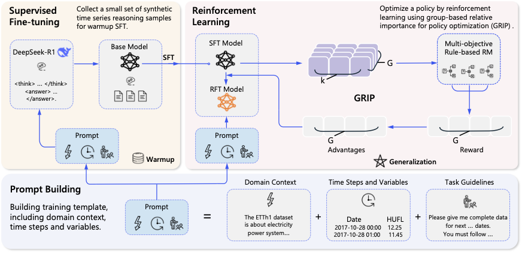
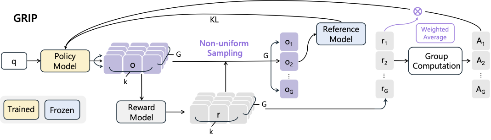

<div align="center">

<h1>Time Series Forecasting via Reasoning: A Slow-Thinking Approach with Reinforcement Fine-Tuned LLMs</h1>

<p>
  <a href="https://cikm2026.diag.uniroma1.it/program/"></a>
  <a href="https://arxiv.org/abs/2506.10630"></a>
  <a href="https://github.com/ustc-time-series/Time-R1"></a>
</p>

<p><strong>Accepted at ACM CIKM 2026 · Full Research Paper · Oral Presentation</strong></p>

<p><a href="https://arxiv.org/abs/2506.10630">Paper</a> · <a href="https://cikm2026.diag.uniroma1.it/program/">CIKM 2026 Program</a> · <a href="https://github.com/ustc-time-series/Time-R1">Code</a></p>

</div>

## 📰 News

- **[Aug. 2026]** 🎉 Our paper **Time-R1** has been accepted at **ACM CIKM 2026** as a **full research paper** and is scheduled for an oral presentation!

## 📖 Abstract

**Time-R1** investigates *slow-thinking* reasoning for time series forecasting. Unlike conventional forecasting methods that directly map historical observations to future values, Time-R1 trains large language models to explicitly analyze temporal dynamics before generating forecasts. Our framework combines **supervised fine-tuning (SFT)** for warm-up adaptation with **reinforcement learning (RL)** for reasoning optimization. It introduces a **fine-grained multi-objective reward** and **GRIP (Group-based Relative Importance for Policy Optimization)**, which uses non-uniform sampling to encourage the exploration of effective reasoning paths. Experiments demonstrate competitive forecasting performance across diverse datasets.

This repository contains the official implementation of our **CIKM 2026** paper:

> **Time Series Forecasting via Reasoning: A Slow-Thinking Approach with Reinforcement Fine-Tuned LLMs**

## 🌟 Overview

<div align="center">

<p><em>Overview of Time-R1.</em></p>
</div>

Large Language Models (LLMs) have demonstrated strong reasoning capabilities, but applying structured multi-step reasoning to time series forecasting remains challenging. **Time-R1** adopts a **two-stage reinforcement fine-tuning (RFT) framework** with forecasting-oriented multi-objective rewards:

1. **Stage 1 — SFT for Warm-up Adaptation:** Teach the model foundational temporal analysis and structured reasoning using supervised fine-tuning on synthetic chain-of-thought data.
2. **Stage 2 — RL for Reasoning Optimization:** Optimize forecasting and reasoning trajectories using rewards informed by ground-truth alignment, multi-horizon accuracy, and domain-specific principles. **GRIP** uses non-uniform group sampling to encourage effective reasoning patterns.

<div align="center">

<p><em>GRIP optimization framework.</em></p>
</div>

## 📚 Resources

- **Training Dataset:** Scripts and configurations for preparing training and evaluation datasets.
- **Time-R1 Model:** Code for training and inference under the two-stage RFT framework.
- **Source Code:** Training and evaluation implementations in this repository.

## ⚙️ Key Features

- **Slow-Thinking Time Series Reasoning:** Enables deliberate, step-by-step analysis of temporal patterns before forecasting.
- **Two-Stage RFT Framework:** Combines SFT warm-up adaptation with RL-based reasoning optimization.
- **GRIP Optimization:** Uses group-based relative importance and non-uniform sampling to explore effective reasoning paths.
- **Fine-Grained Multi-Objective Rewards:** Incorporates forecasting accuracy and temporal reasoning objectives into policy optimization.
- **Forecasting Performance:** Demonstrates competitive performance across diverse real-world datasets.

## 🚀 Quick Start

### Installation

We recommend **Python 3.10+** in a clean `conda` environment. The original implementation specifies **CUDA ≥ 12.4** and **cuDNN ≥ 9.8.0** for training and inference.

```bash
git clone https://github.com/ustc-time-series/Time-R1.git
cd Time-R1
conda create -n time-r1 python=3.10
conda activate time-r1

# Install the verl framework and dependencies
pip install --no-deps -e .
pip install -r requirements.txt
```

## 🛠️ Training

### Time-R1 RL Training

```bash
bash scripts/time-r1.sh
```

## 📈 Evaluation

```bash
cd eval
python main.py
```

## 📝 Citation

If you find **Time-R1** useful for your research, please cite our **CIKM 2026** paper:

```bibtex
@inproceedings{zhou2026timer1,
  title     = {Time Series Forecasting via Reasoning: A Slow-Thinking Approach with Reinforcement Fine-Tuned LLMs},
  author    = {Zhou, Yitong and Luo, Yucong and Cheng, Mingyue and Liu, Qi and Wang, Jiahao and Wang, Daoyu and Chen, Enhong},
  booktitle = {Proceedings of the 35th ACM International Conference on Information and Knowledge Management (CIKM '26)},
  year      = {2026},
  url       = {https://arxiv.org/abs/2506.10630}
}
```

*The citation will be updated with official ACM publication metadata once available.*
